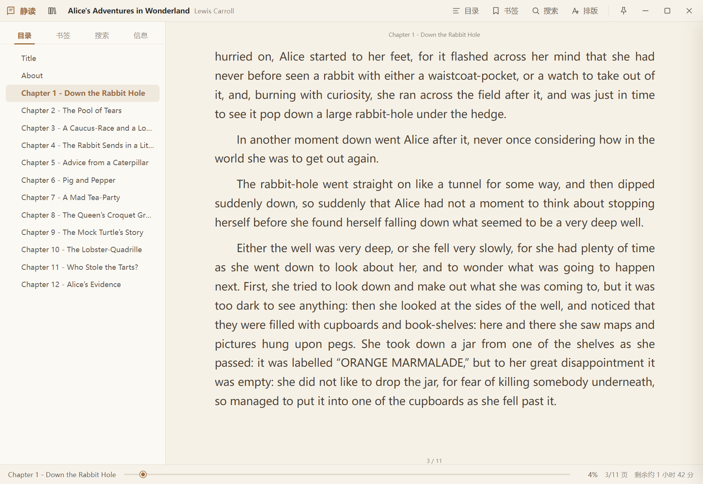
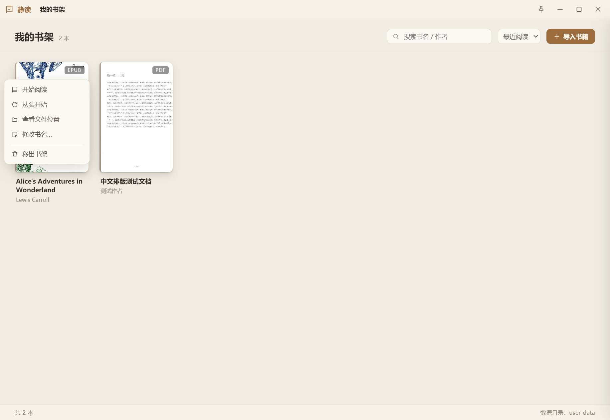
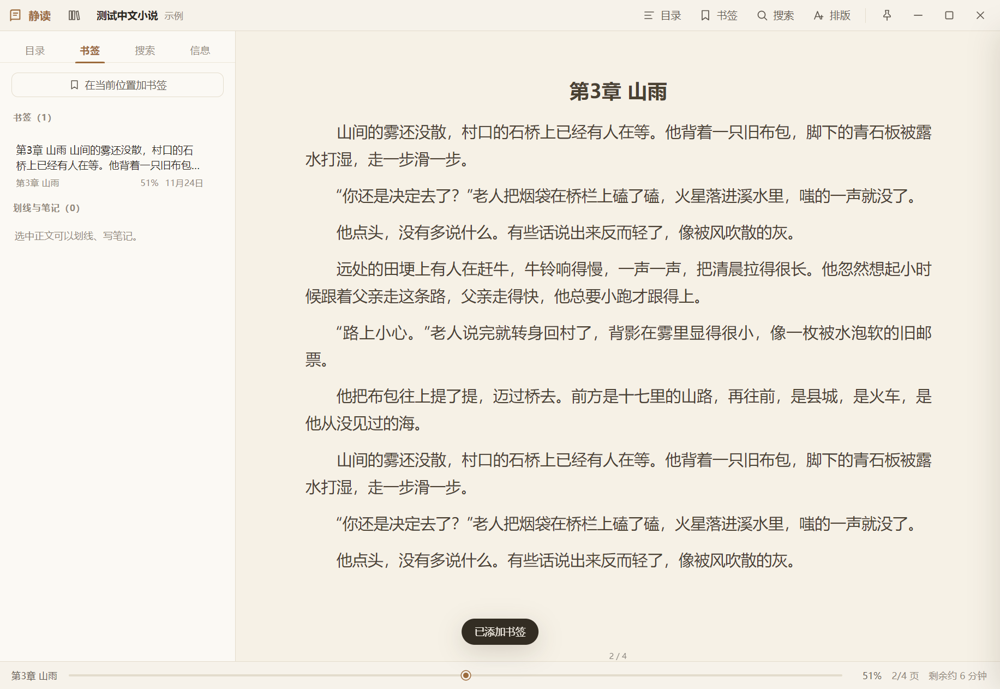
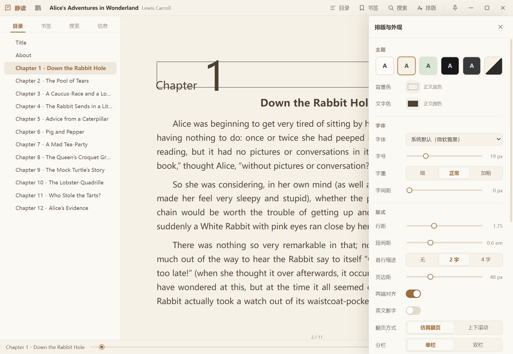
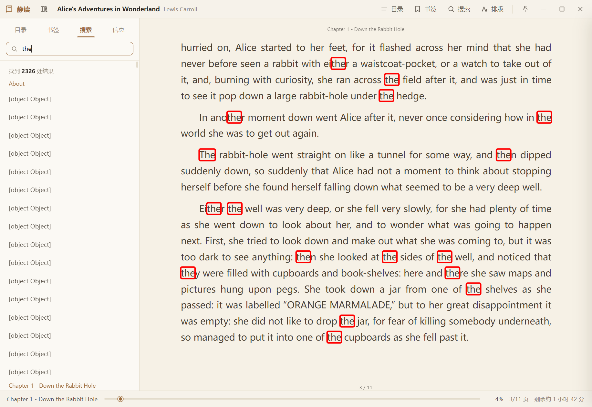
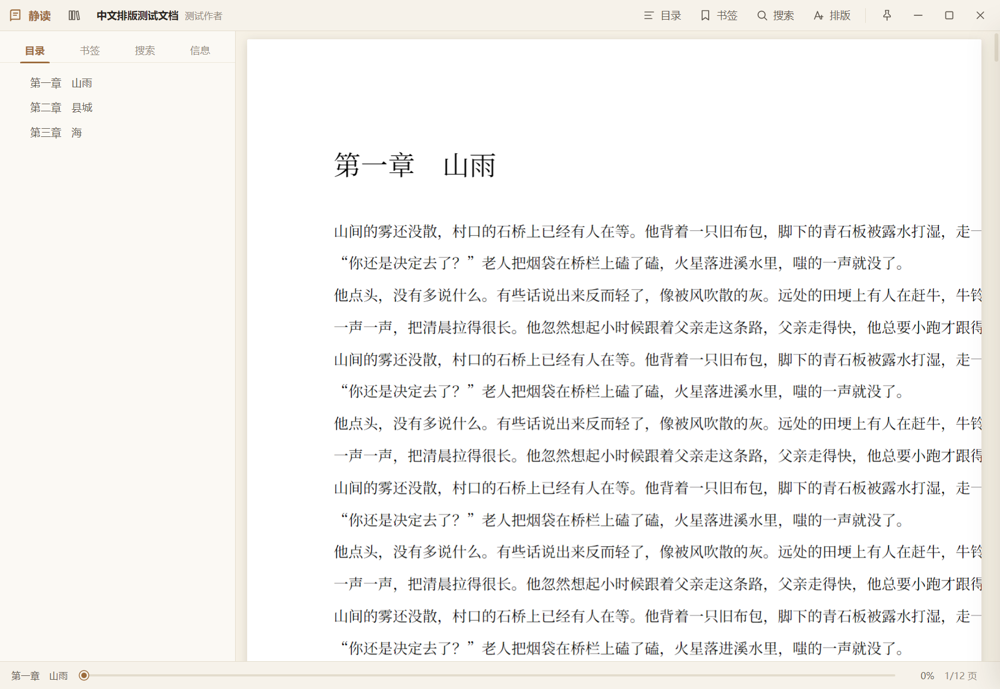

# 静读 · Jingdu Reader

> 一款纯本地、离线、可隐身的桌面电子书阅读器。支持 **EPUB / MOBI / AZW3 / AZW / TXT / PDF / FB2 / CBZ**。

基于 Electron + [foliate-js](https://github.com/johnfactotum/foliate-js) + [PDF.js](https://mozilla.github.io/pdf.js/) 构建，
绿色便携、免安装、不写注册表，所有数据都留在程序自己的目录里。



---

## 功能特性

### 阅读
- **格式**：EPUB、MOBI、AZW3/AZW（KF8 与非 DRM）、TXT（自动分章）、PDF、FB2、CBZ 漫画
- **两种排版流**：分页翻页 / 上下滚动，支持单栏双栏
- **按需渲染**：长书不卡，滚动时按视口渲染章节封面与图片
- **文字选择**：可选中、复制正文，PDF 亦有文字层
- **自动记忆**：退出后重开，回到上次那一页（精确到 CFI 定位 / PDF 页码）

### 排版自定义
- 主题：羊皮纸、白天、夜间、护眼绿，也可单独指定背景色与文字色
- 字体：系统字体 / 自定义字体、字号、字重、字距
- 段落：行距、段间距、首行缩进、两端对齐、连字符、页边距
- 全部实时预览，一键恢复默认

### 导航与标注
- **目录**：左侧侧栏读取书籍自带导航，点击跳转
- **书签**：随时添加，侧栏统一管理
- **划线笔记**：选中即高亮，可批注、删除
- **全文搜索**：命中结果带上下文，点击定位
- **进度条**：拖动跳转任意位置，页眉显示章节名与页码

### 「隐身」模式（为办公内网环境设计）
- 窗口不占用**任务栏**，Alt+Tab 也切不出来（`skipTaskbar` + toolbar 型窗口）
- 最小化即隐藏到**系统托盘**，托盘图标可隐藏
- 全局热键 `Ctrl+Alt+B` 一键呼出 / 收起；`Ctrl+Alt+H` 立即藏起
- 可选「无操作自动隐藏」（N 分钟无操作自动收起）
- 支持窗口置顶、全屏

| 书架 | 目录 / 书签 |
|---|---|
|  |  |

| 排版设置 | 全文搜索 |
|---|---|
|  |  |



---

## 快捷键

| 按键 | 功能 |
|---|---|
| `←` `PageUp` `H` | 上一页 / 左栏 |
| `→` `PageDown` `L` | 下一页 / 右栏 |
| `空格` / `Shift+空格` | 下一页 / 上一页 |
| `↑` `↓` | 上一页 / 下一页（滚动模式下挪动视口） |
| `Home` / `End` | 跳到全书开头 / 结尾 |
| `Ctrl+F` | 全文搜索 |
| `Ctrl+T` | 目录 |
| `Ctrl+B` | 书签与笔记 |
| `Ctrl+D` | 添加书签 |
| `Ctrl+,` | 排版设置面板 |
| `Ctrl+L` | 回到书架 |
| `Ctrl++` / `Ctrl+-` / `Ctrl+0` | 放大 / 缩小 / 还原字号 |
| `Ctrl+W` | 隐藏窗口（不退出） |
| `Esc` | 关闭当前面板 |
| `Ctrl+Alt+B` | 全局：显示 / 隐藏窗口 |
| `Ctrl+Alt+H` | 全局：立即隐藏 |

鼠标滚轮可直接翻页；点击正文左 / 右三分之一区域也可翻页。

---

## 快速开始

需要 **Node.js 18+**（仅开发时需要，成品不需要）。

```bash
npm install     # 安装依赖（Electron + PDF.js）
npm start       # 开发模式启动
```

### 打包绿色版（Windows，免安装）

```bash
bash build-portable.sh
```

产物输出到 `../dist/静读/`，双击其中的 `静读.exe` 即可运行，拷到 U 盘也能用。
阅读数据保存在同目录的 `user-data/`，删掉它等于恢复出厂设置。

> 重新打包时脚本会把旧目录改名成 `静读-old-<时间戳>`，记得把里面的 `user-data/` 拷回新目录，否则书库和进度会“消失”。

### 上传到 GitHub（附带的两个双击脚本）

| 脚本 | 用途 |
|---|---|
| `push-to-github.bat` | **首次**上传：写入提交署名、关联远程仓库、推送 `main` |
| `update-github.bat` | **日常**更新：收集改动 → 提交（可写中文说明）→ 推送；被拒时可自动同步远程后重试 |

脚本会把中文提交说明先转成 UTF-8 再交给 git（Windows 控制台默认 GBK，直接传会变成乱码）。

---

## 目录结构

```
main.js              主进程：窗口、托盘、全局热键、自定义协议、文件读写
preload.js           contextBridge，向渲染层暴露 window.desktop
app/
  index.html         界面骨架
  css/app.css        样式
  js/app.js          渲染层主逻辑：书架、侧栏、搜索、标注、设置
  js/reader.js       BookReader —— 基于 foliate-js 的 EPUB/MOBI/AZW3 阅读器
  js/pdfview.js      PdfReader —— 基于 PDF.js 的 PDF 阅读器
  js/txt.js          TXT → EPUB 转换与自动分章
  js/util.js         通用工具（右键菜单定位等）
  lib/               foliate-js 及相关库（paginator / epubcfi / mobi 解析等）
  lib/pdf/           PDF.js 运行时（worker、cmaps、标准字体）
assets/              托盘与应用图标
docs/screenshots/    README 用截图
```

两个阅读器（`BookReader` / `PdfReader`）对外接口一致：
`open / goTo / next / prev / goToFraction / location / pageInfo / search / addAnnotation`，
所以上层的目录、进度、书签、搜索逻辑可以复用同一套。

---

## 数据与隐私

- 完全离线，**不联网、不上传任何内容**、无统计埋点
- 导入的书籍会复制一份到 `user-data/books/`，阅读进度写在 `user-data/library.json`
- 不写注册表、不写 `%APPDATA%`，卸载 = 删目录

## 已知限制

- 不支持带 **DRM** 的电子书（Amazon 购买的正版 AZW3 通常有 DRM，需先自行去除，本项目不提供相关工具）
- PDF 为整页渲染模式，重排（reflow）不支持
- 主要面向 Windows 开发与测试，macOS / Linux 未做完整验证

## 第三方组件

| 组件 | 许可 |
|---|---|
| [foliate-js](https://github.com/johnfactotum/foliate-js) | MIT |
| [PDF.js](https://mozilla.github.io/pdf.js/) | Apache-2.0 |
| [Electron](https://www.electronjs.org/) | MIT |

## 说明

本项目仅用于个人学习与自用阅读，请勿用于分发受版权保护的书籍。

## License

[MIT](LICENSE)
